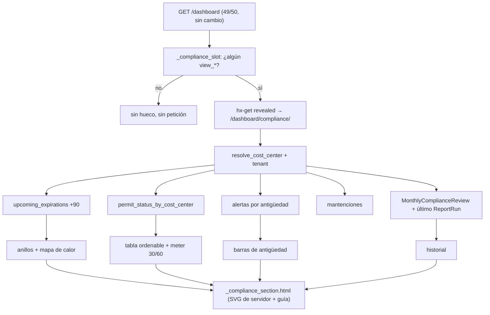

# Sección «Cumplimiento» al final del panel (LV-359)

> Estado: diseño (2026-10-20), nota interna no autoritativa. Pedido de la persona: una sección al final del panel con cumplimiento, gráficos y diseño de tablas atractivo, con el registro visual de cómo revisarlo; diseño moderno como meta. Convive con la franja «Entorno» (`docs/dev/entorno-conjunto.md`).

## 1. Qué contesta

Una sola pregunta: **«¿Estamos al día hoy y qué vence primero?»**, por cinco categorías: papeles, personas, aeronaves, permisos, mantenciones; más el historial de revisión mes a mes. Lo de arriba del panel sigue siendo lo que hay que hacer hoy; esta sección es la vista en profundidad (horizonte de 90 días, desglose por categoría y faena, historial).

## 2. Wireframe (≥992 px; bajo 768 px todo se apila)

```
┌ Cumplimiento ──────────── «A hoy, 20-10-2026» · faena: la del filtro
│ ⓘ Informe mensual DGAC: corte 30-09-2026 · aprobado → (no es «hoy»: va con su fecha)
├─ 5 anillos: Papeles · Personas · Aeronaves · Permisos · Mantención
│   cifra al centro «3 por atender en 30 d»; debajo «✕1 vencido · ▲1 ≤7 · ◆0 ≤15 · ●1 ≤30»
├─ col-7: Vencimientos 90 días, MAPA DE CALOR (tabla HTML): categoría × Vencido | S1…S13, cifra en cada celda
│  col-5: Alertas abiertas por antigüedad 0–7 / 8–30 / >30 días + «N sin responsable»
├─ Permisos por faena: tabla ordenable, <meter> de días restantes (30/60), chips, fila expandible con <details>
├─ Historial de revisión: 6 meses × estado del cierre mensual (LV-262) → monthly-review?month=
└─ ▸ Cómo leer y revisar esta sección (<details>, cerrado por defecto)
```

## 3. Datos (se reutiliza todo, nada se recalcula)

| Bloque | Fuente | Nota |
|---|---|---|
| Anillos y mapa de calor | `upcoming_expirations(today, today+90, cc, user)` (filtra por permiso de cada fuente) y `digest.bucket_for` | Misma función que la tarjeta de arriba con otro corte: vencido y ≤30 deben coincidir (prueba de igualdad) |
| Mantención | `maintenance_qs`, `MaintenanceRecord.needing_planning` | Solo con `view_maintenancerecord` |
| Alertas por antigüedad | `alerts_for_cost_center` con una agregación `Count(filter=Q(...))` | Solo con `view_alert` |
| Permisos por faena | `kpis.permit_status_by_cost_center(today, user)` + `permit_band` (30/60) | Un solo cálculo (LV-246) |
| Historial | `MonthlyComplianceReview` últimos 6 períodos, acotado por tenant | Mismo modelo que LV-262 |
| Informe DGAC | último `ReportRun` (estado y período) leído del modelo | **No** se recalcula ni se mezcla «hoy» con el corte |
| Tendencia (opcional) | `ComplianceSnapshot` 90 días | Depende del timer `snapshot_compliance` en p340 |

## 4. Endpoint, parciales y archivos

`GET /dashboard/compliance/` (`dashboard-compliance`, módulo `apps/dashboard/compliance_section.py`): con htmx devuelve `_compliance_section.html`; sin htmx, la página completa `compliance.html`. Hueco `_compliance_slot.html` con `hx-get` y `hx-trigger="revealed"`, esqueleto, `aria-busy` y `<noscript>`; solo se dibuja si la persona tiene al menos un `view_*` de las fuentes. Se extrae `resolve_cost_center(request, remember=False)` de `dashboard()`. Orden `?sort=&dir=` con lista permitida. Gráficos SVG de servidor (`compliance_charts.py`: `ring`, `hbar`, `sparkline`) con `role="img"`, `<title>`, `<desc>`, cifra impresa al lado y sin `style`; sin JS nuevo. El mapa de calor es una `<table>` real sin `colspan`; las filas expandibles son `<details>` en la celda. CSS: subsección nueva al final de D con tokens `--id-cx-*` (claro/oscuro), sin animación.

## 5. Accesibilidad y contraste

`--sev-warning-*` y `--sev-caution-*` tienen el mismo hex en `app.css`, así que ≤7 y ≤15 se ven igual: símbolo y texto son obligatorios (✕ vencido, ▲ ≤7, ◆ ≤15, ● ≤30, ○ después). Rellenos con `--sev-*-text` (5,75–7,11 claro; 8,1–14 oscuro), nunca `--sev-*-border` (1,58–1,81). Mapa de calor con `--id-cx-heat-1..4`, cada celda con borde y **la cifra es la información**; el paso 4 oscuro queda en 4,52: oscurecerlo. Los pares se suman a `contrast.py` y a un guardián pytest.

## 6. Guía de lectura («registro visual de cómo revisarlo»)

`_compliance_guide.html`, `<details>` cerrado: leyenda de símbolos y colores; umbrales **7/15/30** (documentos y alertas, `digest`) frente a **30/60** (permisos, `kpis.permit_band`); «hoy» frente al «corte del informe»; cinco pasos con su enlace para corregir (Requiere atención, Vencimientos → `alert-list`, Permisos por faena → `permission-list?cost_center=`, Cierre mensual → `monthly-review`, Informe → `monthly-report`).

## 7. Fases (un PR por fase, rama `codex/cumplimiento-*`)

1. `cumplimiento-hueco`: endpoint, hueco, página completa, `resolve_cost_center`, entrada en `LOGIN_ONLY` de `test_lv268`.
2. `cumplimiento-graficos`: template tag SVG, anillos, mapa de calor, alertas por antigüedad, tokens `--id-cx-*`.
3. `cumplimiento-guia`: guía e historial.
4. `cumplimiento-permisos` (decisión D1): tabla ordenable; retira la tabla de mitad de panel y reubica unos cinco tests.
5. Opcional `cumplimiento-tendencia`: sparkline de `ComplianceSnapshot`.

Todas llevan estáticos, ninguna migración. El panel se queda en 49/50 de `test_lv237` (el hueco cuesta 0 consultas); el endpoint tiene su techo medido (≈18) con y sin faena.

## 8. Riesgos

`dashboard()` no acota por tenant (llama a `permit_status_by_cost_center(today)` sin `user`): con varios tenants sección y panel podrían discrepar (F-08 incompleto; hoy hay un solo tenant). Mover la tabla de permisos rompe el ancla del chip mientras la sección no carga: va al final. Con `revealed`, si nadie baja no se carga (aceptable). La tendencia depende del timer `snapshot_compliance`. Nunca mezclar «hoy» con el corte del informe.

## 9. Decisiones (tomadas según lo recomendado; la persona puede revertirlas)

D1 la tabla de permisos se muda a Cumplimiento; D2 endpoint abierto a quien tenga sesión con bloques filtrados por permiso; D3 anillos si caben cinco a 375 px, si no barras; D4 horizonte de 90 días; D5 mostrar el estado del último informe DGAC; D6 activar `snapshot_compliance` en p340 solo si la persona lo confirma (fase 5).


