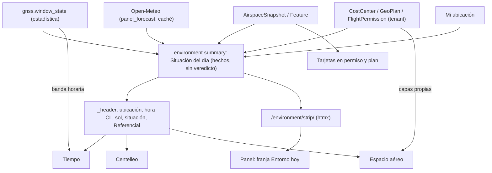

# Sección «Entorno»: tiempo, centelleo GNSS y espacio aéreo en un conjunto (LV-358)

> Estado: diseño (2026-10-20), nota interna no autoritativa. Pedido de la persona: clima, centelleo y el mapa de zonas en una sección informativa, implementados en conjunto sin redundancia. Complementa `docs/dev/espacio-aereo.md` (datos y mapa) y `docs/dev/tiempo.md`.

## 1. Hallazgos que motivan el diseño

1. Cada tarjeta usa una ciudad distinta: el tiempo, la de la persona (`get_location_for`); el centelleo, la ciudad por omisión (Santiago) para no gastar una consulta del presupuesto de `test_lv237`. En la misma fila salen dos puestas de sol que pueden contradecirse.
2. La tarjeta GNSS se dibuja dentro de la página y llama a `panel_forecast()`: con caché fría es una salida a la red de hasta 4 s (`WEATHER_TIMEOUT_SECONDS`) mientras se arma el panel, que `test_lv237` no ve (no es consulta a la base). Pierde lo logrado en LV-353 (htmx).
3. La tarjeta GNSS no pide permiso (solo `GNSS_SCINTILLATION_ENABLED`); como página caería en el guardián LV-268.
4. La advertencia «referencial» aparece tres veces con textos distintos (`wx-legend`, `gn-ref`, la del espacio aéreo).
5. La escena del cielo (LV-356) ya menciona el centelleo; con una banda horaria y la tarjeta serían tres lugares para el mismo dato.

## 2. Arquitectura

**Una sección «Entorno» con pestañas que son rutas reales** (no JS): `/environment/` (redirige a la primera pestaña permitida), `/environment/weather/`, `/environment/gnss/`, `/environment/airspace/` (nombre de URL `airspace-map`). Un solo ítem de menú «Entorno». Cabecera común: selector «Mi ubicación», hora de Chile, amanecer y puesta, «Situación del día», línea fija «Referencial». En el panel, **una franja compacta «Entorno hoy»** (tres celdas y un enlace, cargada por htmx desde `/environment/strip/`) reemplaza `env-row` y sus dos tarjetas; la tarjeta completa del tiempo, con su escena, pasa a la pestaña Tiempo.

## 3. Qué se comparte

| Pieza | Dónde vive | Quién la usa |
|---|---|---|
| Ubicación de referencia (`UserWeatherLocation`, en pantalla «Mi ubicación») | ya existe | Tiempo, puesta del centelleo, centro del mapa |
| Hora de Chile, amanecer y puesta de **un** pronóstico y **una** zona | `apps/environment/summary.py` | Cabecera, ventana GNSS, escena |
| `EnvironmentSummary` («Situación del día»: hechos, nunca veredicto, LV-93) | ídem, función pura | Cabecera y franja |
| Niveles ● Info / ▲ Atención / ◆ Fuerte | módulo común (`levels.py`) | Eventos del tiempo, estado GNSS, frescura de la foto del mapa |
| `_referential.html` (un solo texto de advertencia) | `templates/environment/` | Pestañas y franja |
| `_source.html` (fuente, licencia, «consultado a las», ámbar si vieja) | ídem | Cada pie |
| Tokens `env-*` (subsección E7 de identity.css) y leyenda única `_legend.html` | identity.css | Todos |

La «Situación del día» son tres renglones neutros: eventos previstos (o «Sin eventos notables en 48 h»), ventana típica de centelleo de hoy, y zonas cerca de faenas con permiso vigente con la fecha de la foto. Una prueba impide «puede volar», «apto», «go/no-go» y el color rojo.

## 4. Cruces sin repetir

- El centelleo pasa a **banda horaria** sombreada en la franja de 24 h del Tiempo (con la puesta de la ciudad de la persona); desaparece la línea «Sunset … per the forecast» de la tarjeta GNSS. El guiño de la escena va solo si no hay banda.
- La pestaña Centelleo explica (qué es, temporada sep–abr 2025–2028 en calendario, ventana de esta noche y próximas, portal GEOCOM, supuesto «21–03» declarado); el estado vivo sale de la cabecera.
- Mapa: capas propias «Mis faenas» (coordenadas de `CostCenter`) y «Permisos vigentes» (`GeoPlan`), cada una con su `view_*` y acotada por tenant (F-08). Pronóstico «en este punto» al hacer clic (opcional, reutiliza `panel_forecast` cacheado). **No hay capa regional de clima** (Open-Meteo no entrega polígonos de eventos; dibujarla sería inventarla).
- Las tarjetas «Espacio aéreo cerca» en permiso y plan (fase 4 de espacio aéreo) siguen siendo operativas y enlazan a `/environment/airspace/?near=<permiso>`.

## 5. Permisos (LV-268) y presupuesto

| Pestaña | Permiso |
|---|---|
| Tiempo | `view_userweatherlocation` |
| Centelleo | `view_userweatherlocation` (queda en la tabla del guardián, no en `EXEMPT`) |
| Espacio aéreo | `view_airspacefeature` |
| Franja y cabecera | cada celda revisa el permiso de su fuente |

El hub necesita «cualquiera de» (`has_permission` propio; comprobar que el guardián lo acepta). Quien tiene un solo permiso ve «Entorno» con sus pestañas; la URL de otra da 403; sin ninguno no hay ítem ni franja. El panel queda en **49/50 de `test_lv237` sin cambio** (se afirma en el test); la franja tiene su techo propio medido.

## 6. Decisiones (tomadas según lo recomendado; la persona puede revertirlas)

1. Nombre «Entorno». 2. El panel queda con la franja; la tarjeta completa pasa a la pestaña Tiempo. 3. Centelleo con el permiso del tiempo. 4. Espacio aéreo lo ven los roles que hoy tienen `view_airspacefeature` (Operations) y los que la persona añada. 5. La ubicación de referencia es la ciudad. 6. «Cerca» = 10 km. 7. Ruta `/environment/airspace/`. 8. El guiño del centelleo en la escena se va cuando hay banda.

## 7. Fases (un PR por bloque; despliegue en una sola tanda)

Orden de fusión: `cielo-escena` → E1 → E2 → airspace F1 → airspace F2 → F3 → E3 → F4.

| PR | Rama | Dueño de archivos | Lleva |
|---|---|---|---|
| E1 | `codex/entorno-seccion` | `apps/environment/{apps,views,urls,summary,levels}.py` (sin modelos), `templates/environment/*`, `config/urls.py`, `INSTALLED_APPS`, ítem en `base.html`, `gnss_tags.py` (firma pura), `identity.css` §E7, `.po/.mo` | Estáticos, `.mo` |
| E2 | `codex/entorno-franja` | `templates/dashboard/index.html`, `apps/environment/strip.py`, `_strip.html`, `weather-card.js`, ajustes de `test_lv347/352/237` | Estáticos |
| F3 | `codex/airspace-mapa` | pestaña Espacio aéreo dentro de Entorno (vistas, plantilla, `airspace-map.js`, css) | Estáticos, `.mo` |
| E3 | `codex/entorno-cruces` | banda GNSS en `panel.py`, capas faenas/permisos, celda de espacio aéreo en la franja | Estáticos |
| F4/F5 | como en `espacio-aereo.md` | tarjetas en permiso y plan | Migración (F4) |

Riesgos: colisión de E1/E2 con la escena del cielo (tocan `_panel_card.html`, `panel.py`, `index.html`: esperan su fusión); `identity.css` y el `.mo` se fusionan en serie; la advertencia repetida deja de leerse (por eso un solo texto); la «Situación del día» puede deslizarse a veredicto (prueba de palabras y sin rojo); licencias (Open-Meteo no comercial; el mapa nunca se atribuye como autoría propia de la DGAC sin la confirmación ya anotada).

