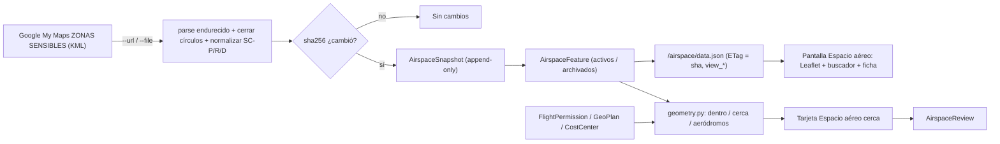

# Espacio aéreo y aeródromos: réplica de «ZONAS SENSIBLES» en AeroControl (LV-357)

> Estado: diseño (2026-10-20), nota interna no autoritativa (ver `AGENTS.md`, precedencia). Pedido de la persona: replicar en una pestaña, más interactivo, claro y técnico, con búsqueda potente y útil para operaciones y permisos, el mapa de zonas que ella identifica como el que muestra la DGAC.
> **Reabre una decisión previa:** `MASTER_PLAN.md` (R8.x) había descartado «NOTAM/restricciones de espacio aéreo» («un dato desactualizado o mal atribuido es peor que no tenerlo»). La petición explícita de la persona lo reabre con **alcance referencial**: nunca decide por el piloto, siempre cita la foto, la fuente y su fecha. También cierra el hueco de `docs/auditoria-iso-trazabilidad.md` §6.1.3 (no hay registro de que se consultaron las zonas).

## 1. Qué trae la fuente (KML público analizado el 2026-10-20)

Fuente: Google My Maps «ZONAS SENSIBLES» (`mid=1T3wWBnClwim-qP1isEKxBO4Xc1Dt6z4`, KML `…/maps/d/kml?mid=…&forcekml=1`). 355 482 bytes, UTF-8, sin NetworkLinks. **572 placemarks en 10 carpetas:**

| Carpeta | N | Geometría | Atributos reales |
|---|---|---|---|
| AERÓDROMOS | 128 | Point | `descripción` y `tracking_href_2` vacíos; el nombre es la única fuente («SCxx Ad/Ap Nombre CIUDAD»); 119 con OACI, 9 sin |
| Pistas chicas | 344 | Point | Sin descripción; 341 rojas y 3 azules sin explicación; solo 10 con OACI; duplicados y puntos antárticos |
| Zonas Prohibidas, Restringuidas, Peligrosas | 55 | 35 Polygon, 13 Point, 7 LineString | 46 con descripción HTML: límites laterales en GMS, verticales («1000 FT AGL GND», «FL 450 / 5000 FT AMSL»), horario («H24», «HJ», «activada por NOTAM»), coordinación y motivo |
| ARMADA DE CHILE Zonas Restringuidas | 15 | LineString, Point, Polygon | Zonas navales de radio 60 yardas |
| REGION INFORMACIÓN DE VUELO | 26 | 19 LineString, Point, Polygon | Límites de FIR como líneas sueltas (no polígonos) |
| 4 capas `.kmz` sueltas | 4 | Polygon / MultiGeometry / LineString | SC-P29, SC-R74, SC-P83, Palacio Pereira |
| Capa sin nombre | 0 | — | Vacía |

Hallazgos de calidad: códigos de zona escritos de forma inconsistente («SC-P29», «SC - R54», «SC R-41», «SC – P 30»; 49 distintos); 17 círculos de 73 vértices como **LineString cerrado** (mismo patrón de los KMZ de Trimble); ayudas de dibujo publicadas como zonas («Medida de círculo», «2 NM», «Punto centrado …»); el estilo no codifica el tipo (sale del código); entradas vencidas a la vista (SC-P51, «OPERACIÓN RPAS EN ISLA DE MAIPO»); duplicados entre carpetas.

**Autoría:** confirmada por la persona el 2026-10-20: es el mapa que la DGAC entrega y lo único oficial por ahora, aunque crudo (el visor dice solo «Un usuario creó este mapa»; la descripción afirma «definidas por la DGAC»). **Sigue sin confirmar:** licencia, fecha de actualización y coincidencia con el AIP-Chile ENR 5.1.

## 2. Decisiones (tomadas según lo recomendado; la persona puede revertirlas)

1. Nombre: **«Espacio aéreo»** (menú) y **«Espacio aéreo y aeródromos»** (pantalla); URL `/airspace/`, app `apps/airspace`. «Zonas sensibles» queda como nombre de la fuente en la atribución.
2. **Los datos viven en la base, no en git** (autoría y licencia sin confirmar, repo público). Pruebas con un KML sintético.
3. Atribución textual por defecto (2026-10-20, ajuste de la persona): «Mapa de zonas sensibles entregado por la DGAC (Google My Maps)»; cadena fuente en inglés en el código, español en el catálogo. Se conserva la advertencia referencial «confirmar contra el AIP-Chile y los NOTAM»: el mapa es crudo y la app no decide por el piloto. Los datos siguen sin ir a git (licencia sin confirmar). Los cambios futuros de la DGAC se absorben re-ejecutando el importador, que reporta agregado/cambiado/archivado.
4. Visibilidad: permiso de modelo `view_airspacefeature` en los roles que ya gestionan permisos de vuelo.
5. «Cerca» = 10 km, con NM visible (configurable).
6. Pistas chicas incluidas, rotuladas «no oficial», ocultas bajo zoom 8.
7. Actualización manual con el comando; la foto se marca ámbar pasados 30 días.
8. `AirspaceReview` (registro de consulta) en una fase aparte.

**Pendiente de la persona:** confirmar quién mantiene el mapa y su licencia; si el AIP-Chile publica ENR 5.1 estructurado (como `/api/aerodrome`), usar este mapa solo de respaldo.

## 3. Modelo y comando

- **`AirspaceSnapshot`** (append-only): `source_name`, `source_url`, `fetched_at`, `sha256`, `feature_count`, `attribution`, resumen de cambios (`added`, `changed`, `archived`), `is_current`.
- **`AirspaceFeature`**: `snapshot` (FK PROTECT), `source_key` (hash de carpeta + nombre normalizado + ordinal entre idénticos; **ajuste de la fase 1:** la geometría salió de la clave y vive en `content_hash`, para que una geometría movida cuente como «cambiado» y no como agregado + archivado), `content_hash`, `archived_in` (FK a la foto que lo retiró; lo cambiado se archiva y se crea una fila nueva, así queda historial), `kind` (aerodrome, airport, airstrip, prohibited, restricted, danger, naval, fir_boundary, aux), `code` (OACI o `SC-R41` normalizado), `name`, `raw_name`, `folder`, `description_text` (HTML a texto plano; nunca `|safe`), `vertical_limits_text` y `schedule_text` (**texto de la fuente**, sin convertir), `geometry` (GeoJSON en JSONField), bbox `min/max_lat/lon`, `center_lat/lon`, `region`/`commune` precalculadas con `administrative.locate` solo para puntos. Sin tenant (catálogo global, como `Aerodrome`).
- **`import_airspace_zones`** (molde: `import_aip_aerodromes`): `--file` o `--url` (la descarga ocurre **solo** en el comando), `--dry-run`; parser endurecido `apps/geo/kml/parse.py`; cierra LineString circulares; normaliza códigos; idempotente por `sha256`; si cambió crea foto nueva y reporta agregado/cambiado/archivado (lo que desaparece se **archiva**, nunca se borra); avisos de calidad; falla con mensaje claro y sin tocar la foto vigente si la fuente no responde.

## 4. Pantalla `/airspace/`

Franja ejecutiva (conteos por tipo, fecha y fuente de la foto, cambios desde la foto anterior, advertencia fija «Referencial. Confirme contra el AIP-Chile y los NOTAM antes de volar»). Panel izquierdo con buscador único (OACI, código de zona en cualquier forma, nombre sin tildes, región/comuna, coordenada decimal o GMS, código de faena, folio de permiso) y filtros; el índice se entrega con `json_script` (<600 entradas). Mapa Leaflet (ya vendorizado) con capas conmutables, patrón y letra además del color, ícono de avión por tipo, FIR punteado. Herramientas: medir distancia (km y NM), círculo de radio, «¿qué hay cerca de aquí?», copiar punto en formato SIGO. Ficha técnica con textos de la fuente y enlace al IFIS. Claro y oscuro con tokens existentes; sin proveedor de fondo nuevo.

## 5. Cruces y lo que NO se inventa

Tarjeta «Espacio aéreo cerca» en permiso y plan: zonas que intersectan el círculo o polígono, zonas a ≤ X km, aeródromos más cercanos de todo el KML. **El AMC no cambia** (sigue del catálogo SIGO, R10.7). `AirspaceReview` (molde `NotamReview`) deja registro de la consulta con la foto citada.

No se inventa: «puede/no puede volar» (la app propone, el papel manda, LV-93); buffers o distancias mínimas sin norma escrita por la persona; conversión de límites verticales a números; si una zona «está activa ahora»; polígonos con las líneas de FIR; oficialidad de las pistas chicas.

## 6. Pruebas

LV-268 (permiso de modelo, 403 sin él); tenant en capas propias; importación con KML sintético (idempotencia, geometría movida = changed, desaparecido = archivado, círculo → Polygon, tabla de normalización de códigos, `<script>` escapado, DOCTYPE rechazado, `--dry-run`, archivo inexistente o mal formado); buscador (OACI, código, tildes, decimal y GMS con hemisferio, folio, faena); geometría (dentro, hueco, borde, círculo que intersecta sin contener el centro); `test_templates` y `test_translations`; verificación en navegador y romper el arreglo una vez.

## 7. Fases (un PR por bloque; despliegue en una sola tanda)

| Fase | Rama | Dueño de archivos | Lleva |
|---|---|---|---|
| 1 | `codex/airspace-modelo` | `apps/airspace/{__init__,apps,models,admin}.py`, migración `0001`, `kml_import.py`, comando, `test_import.py`, fixture sintético, `INSTALLED_APPS`, permiso en `bootstrap_roles` | **Migración**; correr el comando en `p340` |
| 2 | `codex/airspace-geometria` | `apps/airspace/{geometry,search}.py` y sus pruebas (funciones puras) | — |
| 3 | `codex/airspace-mapa` | vistas, urls, plantillas, `airspace-map.js`, `airspace.css`, íconos, enlace en `base.html`, `.po/.mo`, pruebas | **Estáticos** y `.mo` |
| 4 | `codex/airspace-cruces` | `AirspaceReview` + migración, tarjetas en permiso y plan | **Migración** |
| 5 (opcional) | `codex/airspace-faena` | tarjeta en `CostCenter`, CSV de zonas cerca de permisos vigentes | — |

