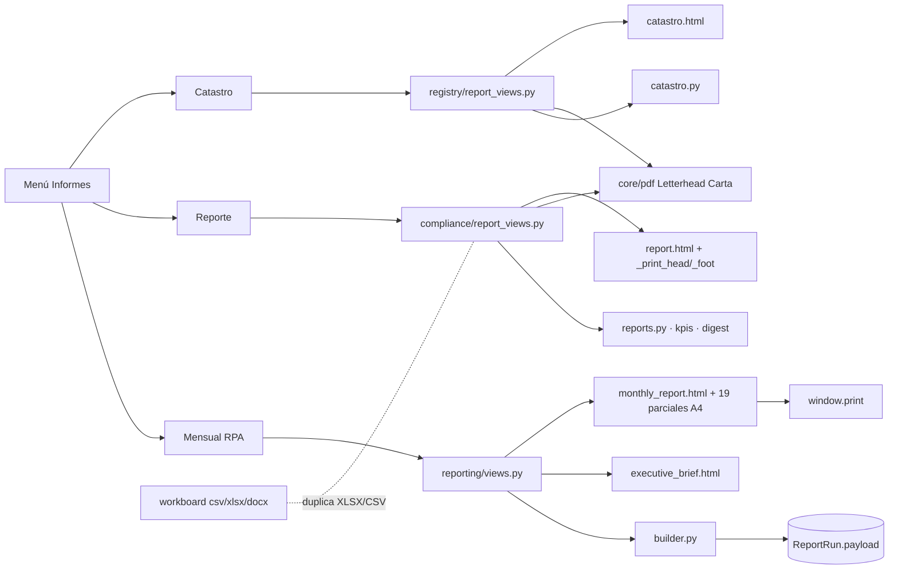
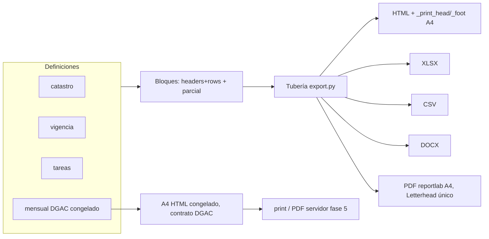
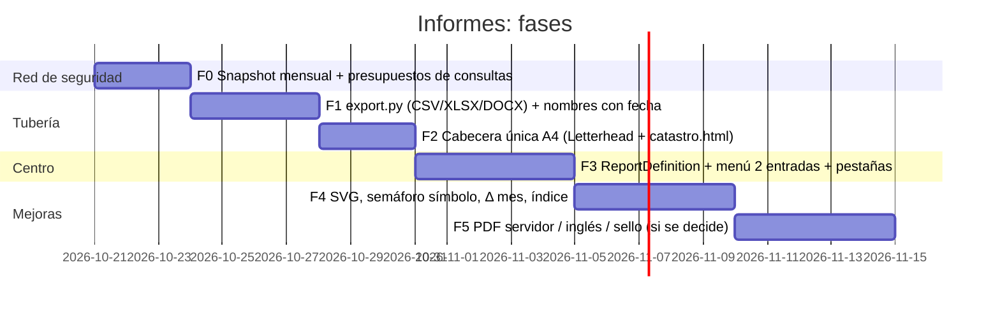

# Informes de AeroControl: diagnóstico y propuesta de optimización

> Estado: propuesta (solo lectura, 2026-10-20). Base: `62796db`. Nota interna, no autoritativa (ver `AGENTS.md`, precedencia documental). Las cuentas de líneas de plantillas son líneas no vacías.
> **Regla de partida:** el A4 del informe mensual a la DGAC es un contrato de salida: se conserva y solo se le agregan pruebas.

## 1. Inventario

| Informe | Pregunta que contesta | Audiencia | Datos | Salidas | Código / plantillas |
|---|---|---|---|---|---|
| **Informe de catastro** `registry-roster` | «¿Qué tengo inscrito hoy?» | Quien lo pide afuera (LV-145: «cuando me soliciten algo») | `build_catastro` (`apps/registry/catastro.py:93`), 2 consultas fijadas por prueba | HTML, PDF reportlab Carta horizontal, XLSX, CSV | `apps/registry/report_views.py`, `templates/registry/catastro.html` |
| **Reporte** `compliance-report` | «¿Están vigentes mis papeles?» | Gerencia y auditor ISO (R6.4, R7.7) | `build_compliance_report` (`apps/compliance/reports.py:524`), `compare_periods`, `operational_kpis`, `permit_counts(today)` | HTML, PDF reportlab Carta, XLSX, DOCX, CSV, adjunto de correo | `apps/compliance/report_views.py`, `templates/compliance/report.html` |
| **Informe mensual RPA** `monthly-report` | «¿Qué reporto a la DGAC sobre el mes cerrado?» | DGAC, firmado (contrato) | `builder.build(period)`, congelado en `ReportRun.payload` | HTML A4, PDF por impresión del navegador (LV-263) | `apps/reporting/` y 19 plantillas `templates/reporting/*` |
| Dato Ejecutivo (LV-235/260) | Lo mismo en una página | Gerencia y DGAC | El mismo payload | HTML A4 | `executive_brief.html` |
| Comparar (LV-251), Textos (LV-249), Narrativa (LV-227) | Edición y control del mensual | Quien redacta y firma | `ReportRun` | Pantalla | `compare.html`, `template_form.html`, `narrative_form.html` |
| Cierre mensual (LV-262) | «¿Qué registros operacionales faltan este mes?» | Operación | `monthly_close_rows` (`apps/compliance/monthly.py`) | HTML y CSV | `monthly_review.html` |
| Informe de tareas | Avance del tablero | Interno | workboard | CSV, XLSX, DOCX | `apps/workboard/views.py` |
| Exportación de listados | Lista filtrada | Interno | `CsvExportMixin` (`apps/core/views.py`) | CSV | ~10 vistas |

**Aclaración:** LV-30 y `test_lv30_monthly` son la revisión mensual de cumplimiento (registros operacionales), no el informe a la DGAC (R3/R5, `apps/reporting`).

## 2. Solapamiento

| # | Qué se repite | Dónde | ¿Redundancia real? |
|---|---|---|---|
| S1 | Tres sistemas de cabecera y pie | `Letterhead` reportlab (`apps/core/pdf.py:90`); `_print_head`/`_print_foot` (LV-319) en `compliance/report.html`; `_head`/`_foot` del A4 mensual. El catastro HTML no incluye `_print_head` | Sí |
| S2 | Tres tamaños de papel | Carta, Carta horizontal, A4 | Sí (en Chile se entrega A4) |
| S3 | Dos motores de PDF | reportlab frente a impresión del navegador | Parcial (el A4 mensual es HTML/CSS por diseño) |
| S4 | Escritores XLSX duplicados | `compliance/report_views.py`, `registry/report_views.py`, `workboard/views.py`; el bucle de autoancho está copiado | Sí |
| S5 | CSV con BOM escrito a mano | 4 sitios, aparte de `CsvExportMixin` | Sí |
| S6 | Lectura del filtro de faena | compliance y registry | Sí (pequeño) |
| S7 | Permisos vigentes: hoy frente a corte | `permit_counts(today)` frente a conteo al corte del mensual | No (LV-233); la etiqueta debe decir «hoy» o «al dd-mm» |
| S8 | Flota y padrón: hoy frente a corte | catastro frente a `panel_readiness(cutoff)` | Legítimo, pero hay que explicarlo (caso 41 frente a 42) |
| S9 | Escala de vigencia 7/15/30 frente a 30/60 | digest/catastro/reporte frente a `kpis.py` | Legítimo |
| S10 | Tabla por faena | Reporte: todas las activas; mensual: solo las que operan y tienen contrato | Legítimo por universo; nombrarlo en cada tabla (LV-265) |
| S11 | Comparación con el período anterior | `reports.compare_periods` (vivo) frente a `reporting/compare.py` (congelado) | Lógica legítima; la presentación puede ser un solo bloque |
| S12 | Nombre de archivo | `aerocontrol-cumplimiento.pdf` sin fecha, `aerocontrol-catastro.pdf`, el mensual usa `document.title` | Sí, inconsistente |
| S13 | Dato Ejecutivo frente a la hoja 2 | mismo payload, dos plantillas | Datos no; plantilla: medir antes de fusionar |

**Diagnóstico:** casi todo el solapamiento está en la tubería y la presentación (S1–S6, S12). En los datos las diferencias son legítimas (audiencia, instante, universo); el problema es que el papel no las declara (S7, S8, S10).

## 3. Arquitectura objetivo

**Propuesta: el menú queda en dos entradas.**
- **«Informes operativos»**, con pestañas Catastro · Vigencia documental · Tareas (datos vivos, filtros, descarga inmediata).
- **«Informe mensual DGAC»**: período, congelado, aprobación y entrega; Dato Ejecutivo y Comparar como pestañas internas.

Dos y no una, porque el mensual tiene ciclo de vida (borrador → congelado → aprobado) y permiso propio (`view_reportrun`); mezclarlo con lo vivo repite el riesgo de imprimir un borrador creyéndolo emitido. «Reporte» pasa a llamarse **«Vigencia documental»**.

Pieza central, `apps/reporting/registry.py`:

```python
@dataclass(frozen=True)
class ReportDefinition:
    key: str; title: str; audience: str            # "operativo" | "oficial"
    permissions: tuple[str, ...]
    filters: type
    build: Callable[[User, Filters], dict]
    sections: tuple[Section, ...]
    formats: frozenset[str]                         # {"html","pdf","xlsx","csv","docx"}
    paper: str = "A4"; orientation: str = "portrait"
    filename: str = "{code}_{as_of:%Y-%m-%d}"
```

`Section(key, title, rows, headers, template)`: cada bloque entrega `headers + rows` una sola vez y de ahí salen HTML, XLSX y CSV (patrón que `catastro.py` ya sigue). Una sola tubería `apps/reporting/export.py` (`to_csv`, `to_xlsx`, `to_docx`, `to_pdf`) absorbe S4, S5 y S12; `neutralize` sigue obligatorio. Una sola cabecera: `_print_head`/`_print_foot` para todo lo operativo; `Letterhead` pasa a A4.

**Se congela:** el A4 mensual completo (`_page1`…`_page6`, `_head`, `_foot`, `report-a4.css`).

### (a) Estado actual



### (b) Arquitectura objetivo



### (c) Flujo del informe mensual

```mermaid
sequenceDiagram
  participant T as Timer día 1-2 / persona
  participant B as builder.build
  participant RR as ReportRun
  participant V as MonthlyReportView
  participant U as Redactor/firmante
  T->>B: generate_monthly_report --period
  B->>RR: freeze(period) rev N (borrador)
  U->>RR: narrativa + acciones (LV-227/235)
  V->>RR: lee payload (no recalcula)
  V-->>U: avisos pre-emisión (LV-265), comparar (LV-251)
  U->>RR: approve() → solo lectura
  U->>V: Descargar PDF (LV-263, print)
  U->>U: entrega a DGAC (día 5; SMTP pendiente R6)
```

## 4. Mejoras sin romper el contrato

**Informe mensual** (portada y 5 hojas intactas; lo nuevo va en pantalla o en anexos opcionales):
1. Gráficos SVG en el servidor (templatetag `svg_bars`, sin JS): días restantes por faena y vencimientos a 90 días; con `<title>`/`<desc>` y la cifra impresa al lado.
2. Semáforo con símbolo y texto (como `.id-chip`, LV-319): se lee en fotocopia en blanco y negro.
3. «Cambios desde el informe anterior» reutilizando `compare_kpis`/`compare_permits`, detrás de un flag (decisión).
4. Índice con enlaces (`#hoja-N`) y anexos que declaran su total.
5. PDF en servidor (fase 5, opcional): metadatos, texto seleccionable, PDF/UA, peso controlado; exige Chromium sin cabeza en la VM (decisión). Si no, estandarizar el título a `JEJ-GTE-CT-INF-RPA-AAAA-MM_Rev{n}`.
6. Bloque `approved_by`/`approved_at` y hash SHA-256 del payload en el pie.
7. Versión en inglés con `translation.override("en")` (los hallazgos son texto libre y no se traducen).

**Catastro y vigencia:** pasar a A4 con cabecera única; nombre `aerocontrol-catastro_2026-10-20.pdf`; frase de universo bajo cada tabla («faenas activas: 14 · con operación: 11»); etiqueta «al dd-mm-aaaa» en cada cifra de permisos.

## 5. Performance

| Informe | Consultas | Medido | Acción |
|---|---|---|---|
| Catastro | 2 + 2 | Sí (`test_lv145_catastro.py`) | No tocar |
| Vigencia | ~3 o más por faena, ×2 por la comparación | No | Presupuesto con `django_assert_max_num_queries`; luego agregar por `GROUP BY cost_center` |
| Mensual congelado | Pocas (lee el payload) | No | No optimizar |
| Mensual en vista previa | `build()` completo en cada GET; el Dato Ejecutivo recalcula | No | Medir; cachear 5 min con clave `(period, max(updated_at))` solo en la vista previa |

El payload congelado ya es la caché del mes cerrado. Segundo plano solo si el PDF pasa al servidor.

## 6. Plan por fases



| Fase | Archivos (dueño exclusivo) | Pruebas clave | Criterio de aceptación |
|---|---|---|---|
| F0 | `apps/reporting/test_snapshot_monthly.py`, fixtures del snapshot, `test_*_query_budget.py` | HTML normalizado de un `ReportRun` fijo (mensual y Dato Ejecutivo) | Snapshot verde y presupuesto de consultas fijado en los 3 informes |
| F1 | `apps/reporting/export.py` (nuevo), `compliance/report_views.py`, `registry/report_views.py`, `workboard/views.py` | `test_reports`, `test_lv145_*`, workboard, `test_lv144_*` | Escritores XLSX 4→1, CSV con BOM 4→1, 100 % de nombres `stem_AAAA-MM-DD` |
| F2 | `core/pdf.py`, `registry/catastro.html`, `identity.css` sección D | `test_lv319_print_sheet`, `test_lv144_*`, `test_lv145_catastro_views`, `test_lv149` | Cabeceras 3→2, tamaños de papel 3→1 (A4) |
| F3 | `apps/reporting/registry.py`, `views_hub.py`, `hub.html`, `blocks/*`, `base.html` | prueba de nav (`nav-reports`) | Se conservan los nombres de URL: menú 3→2 con pestañas, 0 URL rotas |
| F4 | `templatetags/report_svg.py`, `_page2_summary.html` (solo la franja), `blocks/_compare.html` | Snapshot (diferencia aprobada a mano), `test_lv259_contrast` | Diferencias no aprobadas en la salida del mensual: 0 |
| F5 | Según la decisión | `test_lv263_download_pdf` | PDF con metadatos y texto seleccionable, < 1 MB |

**Riesgos:** las pruebas localizan por clase y texto (`rpt-sheet`, `id-print-head`, `class="page-header d-print-none"`, `data-print-title`): no se renombran clases. `test_lv30_monthly` y `test_lv262_monthly_close` son del cierre y no se tocan. No existe snapshot del mensual: F0 va primero. El reporte de vigencia no recibe `user` ni tenant: unificar en `build(user, …)` sin cambiar cifras.

**Verificación:** `scripts/verify.ps1` en cada fase; en F0, F2 y F4 contar páginas del PDF impreso con `msedge --headless --print-to-pdf` y `pypdf` (método de LV-263). El mensual de agosto debe seguir en 5 hojas más el anexo.

## 7. Decisiones

**Se pueden decidir ya:** no tocar el A4 mensual; snapshot primero; una sola tubería `export.py`; A4 en todo; nombres con fecha; conservar nombres de URL; renombrar «Reporte» a «Vigencia documental»; presupuestos de consultas; no cachear el mensual congelado.

**Las decide la persona:**
1. Menú en dos entradas o una sola con pestañas.
2. Si la franja de cambios y los gráficos entran en el papel a la DGAC o solo en pantalla (en el papel cambia el contrato).
3. PDF en servidor (Chromium sin cabeza en la VM) o seguir con la impresión del navegador.
4. Sello o hash y bloque de aprobación en el pie.
5. Versión en inglés: si hace falta y para quién.
6. Si el informe de tareas entra al centro de informes.
7. Si el cierre mensual (LV-262) alimenta el indicador pendiente `pct_bitacoras_cargadas` (MAPPING:90, R7).
